# 🚗 Sistema de Aluguel de Carros 👨‍💻

> [!NOTE]
> Sistema web para gestão de aluguéis de automóveis: clientes criam, modificam, consultam e cancelam pedidos pela Internet, e agentes (empresas e bancos) avaliam financeiramente os pedidos e executam os contratos.

<table>
  <tr>
    <td width="800px">
      <div align="justify">
        Projeto do <b>Laboratório 02</b> da disciplina <b>Desenvolvimento e Integração de Aplicações Web (DIAW)</b>, do curso de Engenharia de Software da PUC Minas, sob orientação do <a href="https://github.com/joaopauloaramuni">Prof. Dr. João Paulo Aramuni</a>. O sistema exige cadastro e autenticação prévios e é dividido em dois subsistemas: <b>gestão de pedidos e contratos</b> e <b>construção dinâmica das páginas web</b>. Foi desenvolvido com <b>Spring Boot</b> no back-end (arquitetura MVC), <b>React + Vite</b> no front-end e <b>Supabase (PostgreSQL)</b> como banco de dados.
      </div>
    </td>
    <td>
      <div>
        
      </div>
    </td>
  </tr>
</table>

---

## 🚧 Status do Projeto

     


## 📚 Índice
- [Links Úteis](#-links-úteis)
- [Sobre o Projeto](#-sobre-o-projeto)
- [Funcionalidades Principais](#-funcionalidades-principais)
- [Tecnologias Utilizadas](#-tecnologias-utilizadas)
- [Arquitetura](#-arquitetura)
  - [Diagramas](#diagramas)
- [Instalação e Execução](#-instalação-e-execução)
  - [Pré-requisitos](#pré-requisitos)
  - [Variáveis de Ambiente](#-variáveis-de-ambiente)
     - [1. Back-end (Spring Boot)](#1-back-end-spring-boot)
     - [2. Front-end (React, Vite)](#2-front-end-react-vite)
  - [Instalação de Dependências](#-instalação-de-dependências)
  - [Inicialização do Banco de Dados](#-inicialização-do-banco-de-dados-supabase--postgresql)
  - [Como Executar a Aplicação](#-como-executar-a-aplicação)
- [Deploy](#-deploy)
- [Estrutura de Pastas](#-estrutura-de-pastas)
- [Demonstração](#-demonstração)
- [Testes](#-testes)
- [Documentações utilizadas](#-documentações-utilizadas)
- [Autores](#-autores)
- [Contribuição](#-contribuição)
- [Agradecimentos](#-agradecimentos)
- [Licença](#-licença)

---

## 🔗 Links Úteis
* 📐 **Modelagem UML e Histórias de Usuário:** [`/docs`](./docs)
  > 📚 **Descrição:** Diagramas de casos de uso, classes e pacotes (todas as versões) e histórias de usuário.
* 📄 **Enunciado do laboratório:** [PDF](./DIAW_-_LABORATÓRIO_02_-_Sistema_de_Aluguel_de_Carros.pdf)
* 🌐 **Demo Online:** _não publicada (execução local, ver [Como Executar](#-como-executar-a-aplicação))._

---

## 📝 Sobre o Projeto
Pretende-se apoiar a gestão de aluguéis de automóveis, permitindo efetuar, cancelar e modificar pedidos através da Internet.

- **Contexto:** trabalho acadêmico (Laboratório 02, DIAW, PUC Minas).
- **Problema que resolve:** centraliza o ciclo de vida do aluguel — do pedido do cliente à análise financeira pelo agente e à execução do contrato (incluindo contrato de crédito concedido por um banco).
- **Quem usa:**
  - **Clientes (usuários individuais):** introduzem, modificam, consultam e cancelam pedidos de aluguel.
  - **Agentes (empresas e bancos):** modificam e avaliam pedidos. Em caso de parecer financeiro positivo, o pedido é colocado à consideração do cliente para execução do contrato.
- **Dados armazenados:**
  - *Contratantes:* RG, CPF, nome, endereço, profissão, entidades empregadoras e respectivos rendimentos (máximo 3).
  - *Automóveis:* matrícula, ano, marca, modelo e placa. Conforme o tipo de contrato, podem ser propriedade de clientes, empresas ou bancos.
  - *Contrato de crédito:* o aluguel pode estar associado a um crédito concedido por um dos bancos agentes.

---

## ✨ Funcionalidades Principais

- 🔐 **Autenticação:** cadastro prévio e login obrigatório (usuário e senha, JWT) para clientes e agentes (Empresa e Banco).
- 👤 **CRUD de Cliente:** cadastro com RG, CPF, nome, endereço, profissão e até 3 rendimentos.
- 🚘 **Automóveis:** matrícula, ano, marca, modelo, placa e proprietário (quem cadastra).
- 📝 **Pedidos de aluguel:** o cliente cria, modifica, consulta e cancela pedidos e acompanha o status.
- 🧮 **Avaliação por agentes:** empresas e bancos analisam financeiramente e modificam pedidos.
- 📄 **Contratos:** o cliente executa o pedido aprovado e nasce o contrato de aluguel.
- 🏦 **Contrato de crédito:** um banco associa crédito (valor e juros) ao contrato.

---

## 🛠 Tecnologias Utilizadas

### 💻 Front-end

* **Framework/Biblioteca:** React
* **Linguagem:** JavaScript (ES6+)
* **Build Tool:** Vite
* **Requisições HTTP:** Axios
* **Roteamento:** React Router

### 🖥️ Back-end

* **Linguagem/Runtime:** Java (JDK 25)
* **Framework:** Spring Boot 4.0.x (arquitetura MVC)
* **Build e dependências:** Apache Maven
* **Banco de Dados:** Supabase (PostgreSQL)
* **ORM:** Spring Data JPA / Hibernate
* **Autenticação:** Spring Security (login com usuário e senha)

### ⚙️ Infraestrutura & DevOps

* **Banco de dados em nuvem:** Supabase
* **Versionamento:** Git e GitHub

---

## 🏗 Arquitetura

O back-end segue o padrão **MVC** em camadas (`controller` → `service` → `repository` → `model`), com **DTOs** para entrada/saída da API, tratamento global de exceções (`@RestControllerAdvice`) e segurança **stateless com JWT** (Spring Security). O front-end React consome a API REST e guarda o token para enviá-lo no header `Authorization: Bearer`.

- **Padrões adotados:** MVC, Service Layer, Repository, DTO.
- **Fluxo de dados:** página React → serviço (Axios) → `controller` → `service` → `repository` → Supabase (PostgreSQL).
- **Decisão importante:** Empresa e Banco são o `tipoAgente` de um usuário `AGENTE`, e o proprietário do automóvel é o `Usuario` que o cadastrou.

O sistema é subdividido em dois subsistemas:
1. **Gestão de pedidos e contratos** (back-end).
2. **Construção dinâmica das páginas web** (front-end).

### Diagramas

Todas as versões ficam em [`/docs`](./docs) (fonte `.puml` e `.png`). A **v3** é a mais recente e reflete todo o código implementado (inclui contrato, contrato de crédito, Empresa/Banco e proprietário do automóvel).

| Diagrama de Casos de Uso | Diagrama de Classes | Diagrama de Pacotes |
| :---: | :---: | :---: |
| <a href="./docs/casos_de_uso_v3.png">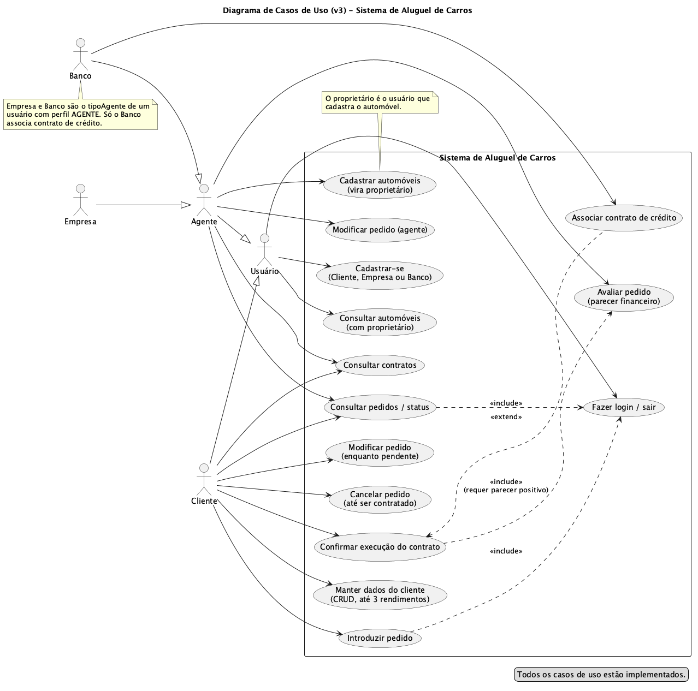</a> | <a href="./docs/classes_v3.png">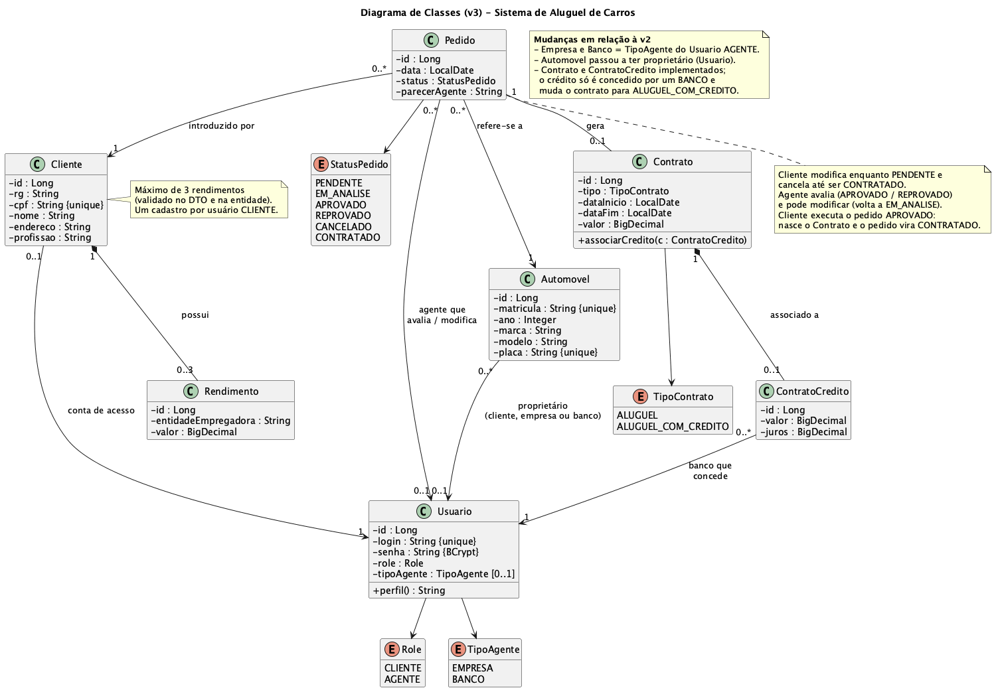</a> | <a href="./docs/pacotes_v3.png">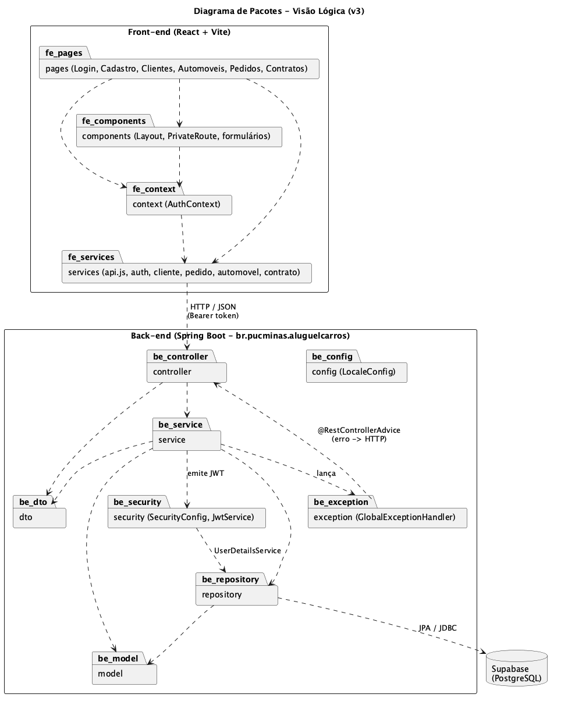</a> |
| [v1](./docs/casos_de_uso_v1.puml) · [v2](./docs/casos_de_uso_v2.puml) · [**v3**](./docs/casos_de_uso_v3.puml) | [v1](./docs/classes_v1.puml) · [v2](./docs/classes_v2.puml) · [**v3**](./docs/classes_v3.puml) | [v1](./docs/pacotes_v1.puml) · [v2](./docs/pacotes_v2.puml) · [**v3**](./docs/pacotes_v3.puml) |

As **histórias de usuário**, com o status de implementação, estão em [`docs/historias.md`](./docs/historias.md).

---

## 🔧 Instalação e Execução

### Pré-requisitos

* **Java JDK:** versão **25** ou superior
* **Maven:** 3.9+
* **Node.js:** 22 LTS ou superior (com npm)
* **Conta no Supabase** com um projeto PostgreSQL criado

---

### 🔑 Variáveis de Ambiente

#### 1. Back-end (Spring Boot)

Configure como variáveis de ambiente do sistema (nunca versione senhas):

| Variável | Descrição | Exemplo |
| :--- | :--- | :--- |
| `SERVER_PORT` | Porta do Back-end. | `8080` |
| `SPRING_DATASOURCE_URL` | URL JDBC do Supabase (aba *Connect*). | `jdbc:postgresql://<host>:5432/postgres?sslmode=require` |
| `SPRING_DATASOURCE_USERNAME` | Usuário do banco. | `postgres` |
| `SPRING_DATASOURCE_PASSWORD` | Senha do banco. | `********` |
| `APP_JWT_SECRET` | Segredo para assinar os JWT (mín. 32 caracteres). Gere com `openssl rand -base64 48`. | `********` |
| `APP_JWT_EXPIRATION_MINUTES` | (opcional) Validade do token em minutos. Padrão: 120. | `120` |

#### 2. Front-end (React, Vite)

Crie `/frontend/.env.local`:

| Variável | Descrição | Exemplo |
| :--- | :--- | :--- |
| `VITE_API_URL` | URL base da API Spring Boot. | `http://localhost:8080` |

---

### 📦 Instalação de Dependências

```bash
git clone https://github.com/elijuniordd/lab2-diaw.git
cd lab2-diaw
```

#### Front-end (React)
```bash
cd frontend
npm install
cd ..
```

#### Back-end (Spring Boot)
```bash
cd backend
./mvnw clean install
cd ..
```

---

### 💾 Inicialização do Banco de Dados (Supabase / PostgreSQL)

1. Crie um projeto em [supabase.com](https://supabase.com).
2. Em **Connect**, copie host, porta, usuário e senha e monte a `SPRING_DATASOURCE_URL`.
3. O schema é criado automaticamente pelo Hibernate (`ddl-auto`) na primeira execução do Back-end. As tabelas aparecem no *Table Editor* do Supabase.

---

### ⚡ Como Executar a Aplicação

Em **dois terminais separados**:

**Primeira vez: arquivo de variáveis do back-end**
```bash
cd backend
cp .env.example .env        # preencha com os dados do Supabase e o APP_JWT_SECRET (o .env não vai para o git)
```

#### Terminal 1: Back-end (Spring Boot)
```bash
cd backend
set -a; source .env; set +a   # carrega as variáveis (o Maven não lê .env sozinho)
./mvnw spring-boot:run
```
🚀 *Disponível em **http://localhost:8080**.*

#### Terminal 2: Front-end (React, Vite)
```bash
cd frontend
npm run dev
```
🎨 *Disponível em **http://localhost:5173**.*

#### ✅ Testando o fluxo completo

1. Abra `http://localhost:5173`: sem login você é redirecionado para `/login`.
2. **Cadastre-se** como *Cliente* e como *Agente* (Empresa e Banco; três contas) e faça login.
3. Como **Agente**, em *Automóveis*, cadastre um automóvel (você vira o proprietário).
4. Como **Cliente**, em *Clientes*, preencha o cadastro (CPF válido, até 3 rendimentos).
5. Como **Cliente**, em *Pedidos*, crie um *Novo pedido*: ele aparece com status **Pendente**.
6. Como **Agente**, em *Pedidos*, avalie o pedido (aprovar/reprovar com parecer).
7. Como **Cliente**, volte a *Pedidos*, veja o novo status e, se **Aprovado**, clique em *Executar contrato* (período e valor): o pedido vira **Contratado**.
8. Como **Agente Banco**, em *Contratos*, clique em *Associar crédito* (valor e juros): o contrato vira *Aluguel com crédito*.

#### 🔌 Principais endpoints

| Método e rota | Quem acessa |
| :--- | :--- |
| `GET /health` | público |
| `POST /auth/register`, `POST /auth/login` | público |
| `GET /auth/me` | autenticado |
| `GET/POST/PUT/DELETE /clientes` | CLIENTE (o próprio cadastro); AGENTE só consulta |
| `GET /automoveis` | autenticado |
| `POST /automoveis` | AGENTE (quem cadastra vira o proprietário) |
| `POST /pedidos`, `PUT /pedidos/{id}`, `PUT /pedidos/{id}/cancelar` | CLIENTE (dono do pedido) |
| `GET /pedidos`, `GET /pedidos/{id}` | CLIENTE (os seus) ou AGENTE (todos) |
| `PUT /pedidos/{id}/avaliar` | AGENTE |
| `POST /contratos` (executa pedido `APROVADO`) | CLIENTE (dono do pedido) |
| `GET /contratos`, `GET /contratos/{id}` | CLIENTE (os seus) ou AGENTE (todos) |
| `POST /contratos/{id}/credito` | AGENTE do tipo BANCO |

---

## 🚀 Deploy

1. **Build do projeto** (JAR para o Back-end e arquivos estáticos para o Front-end):

```bash
# Front-end (React/Vite) - gera a pasta /dist
cd frontend
npm run build

# Back-end (Spring Boot/Maven) - gera o .jar executável em /target
cd ../backend
./mvnw clean package
```

2. **Configuração do ambiente de produção:** defina as variáveis de ambiente no provedor escolhido.

> 🔑 **Variáveis cruciais:** `SPRING_DATASOURCE_URL`, `SPRING_DATASOURCE_USERNAME`, `SPRING_DATASOURCE_PASSWORD`, `APP_JWT_SECRET` e `APP_CORS_ALLOWED_ORIGINS` (URL do Front-end) no Back-end; `VITE_API_URL` (URL da API) no Front-end, definida **antes** do `npm run build`.

3. **Execução em produção:**

```bash
# Back-end
java -jar backend/target/aluguelcarros-0.0.1-SNAPSHOT.jar

# Front-end (arquivos estáticos servidos por um servidor web)
npm install -g serve
serve -s frontend/dist
```

---

## 📂 Estrutura de Pastas

```
.
├── .gitignore                   # Arquivos/pastas não versionados (.env, node_modules, target, etc.).
├── README.md                    # Documentação principal do projeto.
│
├── /frontend                    # Aplicação React + Vite
│   └── /src
│       ├── /components          # Componentes reutilizáveis (Layout, PrivateRoute, formulários).
│       ├── /context             # AuthContext (sessão e token JWT).
│       ├── /pages               # Páginas (Login, Cadastro, Clientes, Automóveis, Pedidos, Contratos).
│       └── /services            # Chamadas HTTP (Axios, com interceptor do token).
│
├── /backend                     # Aplicação Spring Boot
│   └── /src/main/java/br/pucminas/aluguelcarros
│       ├── /controller          # Endpoints REST.
│       ├── /service             # Regras de negócio.
│       ├── /repository          # Repositórios (JPA).
│       ├── /model               # Entidades JPA.
│       ├── /dto                 # Data Transfer Objects.
│       ├── /config              # Configurações (CORS, etc.).
│       ├── /exception           # Exceptions e handlers globais.
│       └── /security            # Autenticação e autorização (Spring Security).
│
└── /docs                        # Diagramas UML (todas as versões) e histórias de usuário.
```

---

## 🎥 Demonstração

Capturas do protótipo em execução, seguindo o fluxo completo: cadastro → pedido → avaliação → contrato → crédito.

### 🌐 Aplicação Web

| Tela | Captura de Tela |
| :---: | :---: |
| **Login** | **Criar conta (perfil Cliente, Empresa ou Banco)** |
| 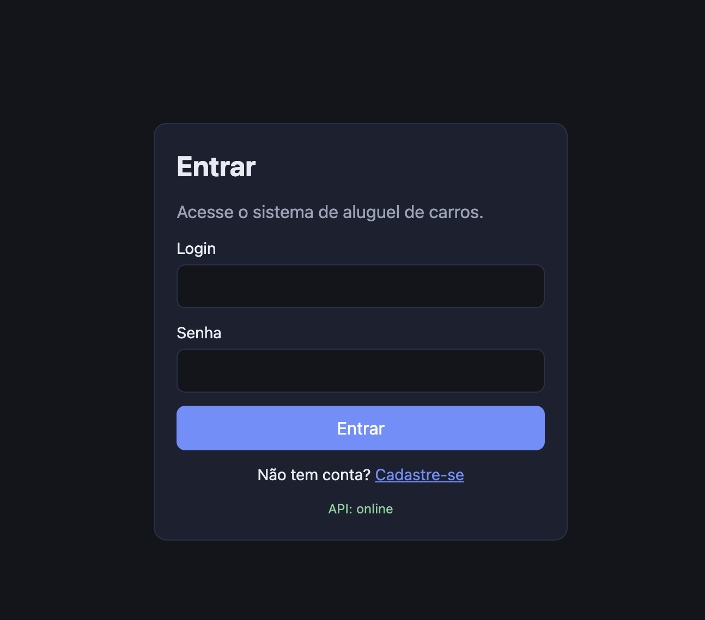 | 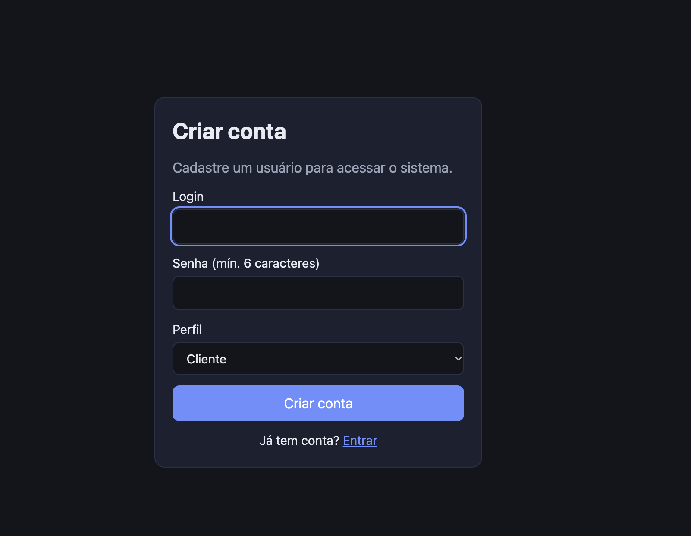 |
| **Cadastro de Cliente (até 3 rendimentos)** | **Cadastro de Automóvel (Agente Empresa)** |
| 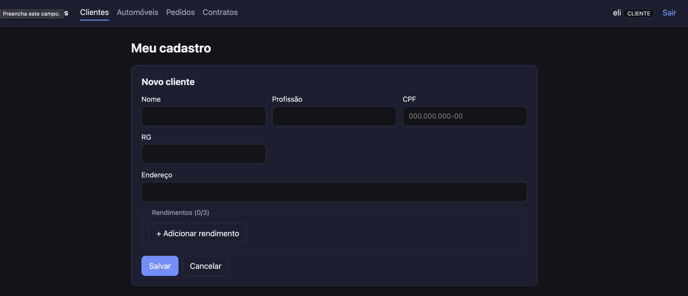 | 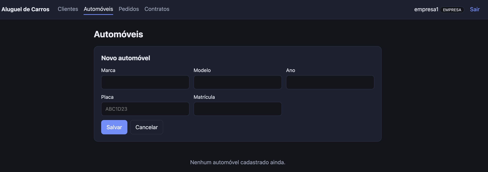 |
| **Novo pedido de aluguel (Cliente)** | **Meus pedidos: status Pendente** |
| 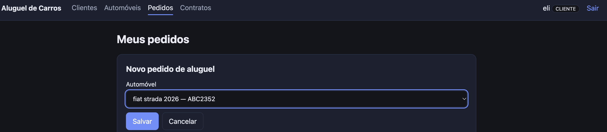 | 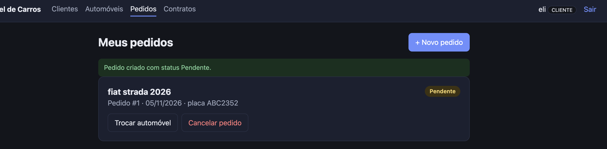 |
| **Avaliação financeira do pedido (Agente)** | **Pedido Aprovado: botão "Executar contrato"** |
| 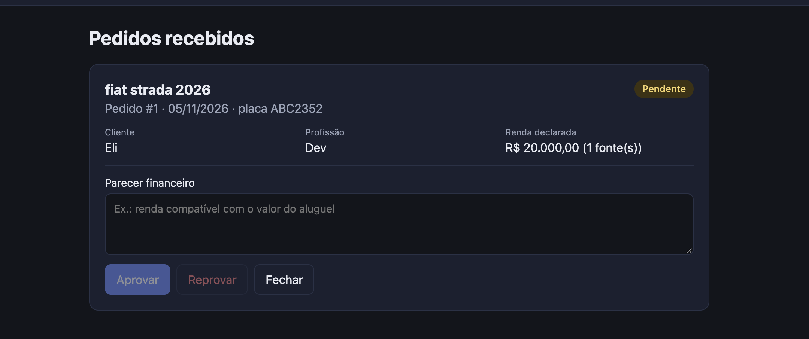 | 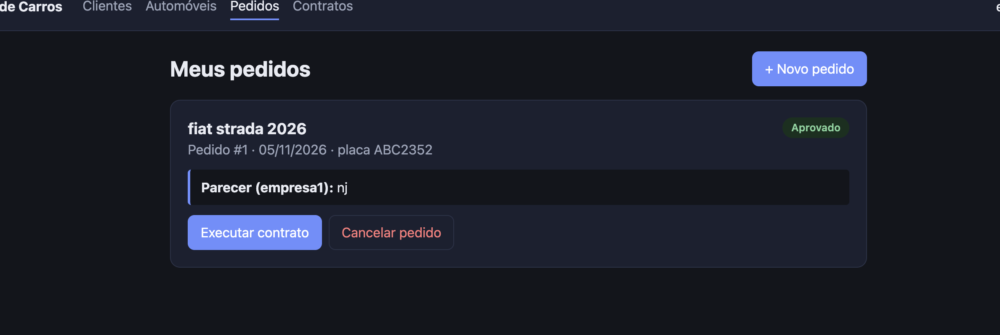 |
| **Contratos e associação de crédito (Banco)** | |
| 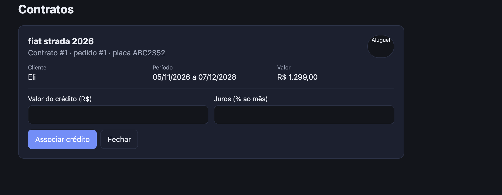 | |

### 💻 Exemplo de saída no Terminal (API)

```bash
# Health check (público)
curl http://localhost:8080/health

# Login
curl -X POST http://localhost:8080/auth/login \
  -H "Content-Type: application/json" \
  -d '{"login":"cliente1","senha":"senha123"}'

# Listar os pedidos do cliente logado
curl http://localhost:8080/pedidos -H "Authorization: Bearer <token>"
```

---

## 🧪 Testes

### Testes Unitários e de Integração

**Back-end:**
```bash
cd backend
./mvnw test
```
*Ferramenta utilizada: JUnit 5 (Spring Boot Test + MockMvc). Os testes de integração usam um banco H2 em memória, então **não dependem do Supabase** nem de variáveis de ambiente. Cobrem autenticação, cliente, pedidos, automóveis, contratos e crédito.*

**Front-end:**
```bash
cd frontend
npm run lint
npm run build
```
*Ainda não há testes automatizados no front-end; o fluxo é validado manualmente (ver "Testando o fluxo completo").*

### Testes End-to-End (E2E)
Ainda não implementados.

---

## 🔗 Documentações utilizadas

* 📖 **Framework/Biblioteca (Front-end):** [Documentação Oficial do **React**](https://react.dev/)
* 📖 **Build Tool (Front-end):** [Guia do **Vite**](https://vitejs.dev/guide/)
* 📖 **Framework (Back-end):** [Documentação Oficial do **Spring Boot**](https://docs.spring.io/spring-boot/index.html)
* 📖 **Banco de dados:** [Documentação do **Supabase**](https://supabase.com/docs)
* 📖 **Guia de Estilo:** [**Conventional Commits** (Padrão de Mensagens)](https://www.conventionalcommits.org/en/v1.0.0/)
* 📖 **Documentação Interna:** [Modelagem UML e Histórias de Usuário](./docs)

---

## 👥 Autores

| 👤 Nome | 🖼️ Foto | :octocat: GitHub | 📤 Gmail |
|---------|----------|-----------------|-----------|
| Eli Junior Dias | <div align="center"></div> | <div align="center"><a href="https://github.com/elijuniordd"></a></div> | <div align="center"><a href="mailto:elijuniordias098@gmail.com"></a></div> |

---

## 🤝 Contribuição

1. Faça um `fork` do projeto.
2. Crie uma branch para sua feature (`git checkout -b feature/minha-feature`).
3. Commit suas mudanças (`git commit -m 'feat: adiciona nova funcionalidade X'`). **(Utilize [Conventional Commits](https://www.conventionalcommits.org/en/v1.0.0/))**
4. Faça o `push` para a branch (`git push origin feature/minha-feature`).
5. Abra um **Pull Request (PR)**.

---

## 🙏 Agradecimentos

* [**Engenharia de Software PUC Minas**](https://www.instagram.com/engsoftwarepucminas/) - Pelo apoio institucional e estrutura acadêmica.
* [**Prof. Dr. João Paulo Aramuni**](https://github.com/joaopauloaramuni) - Pelos ensinamentos sobre **Arquitetura de Software** e **Padrões de Projeto**, e pelo template deste README.

---

## 📄 Licença

Projeto acadêmico, desenvolvido para fins educacionais.

---
